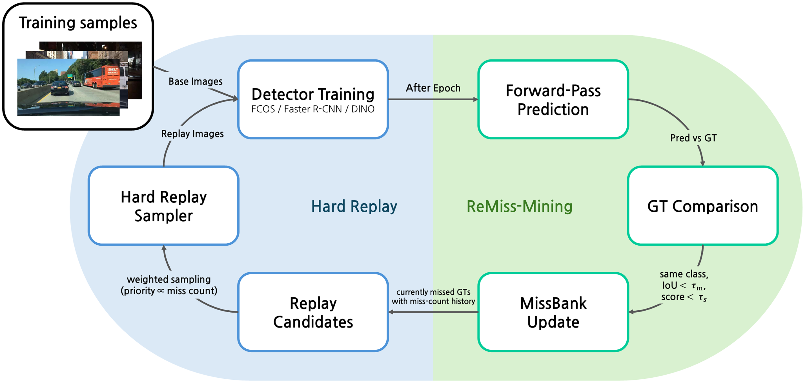
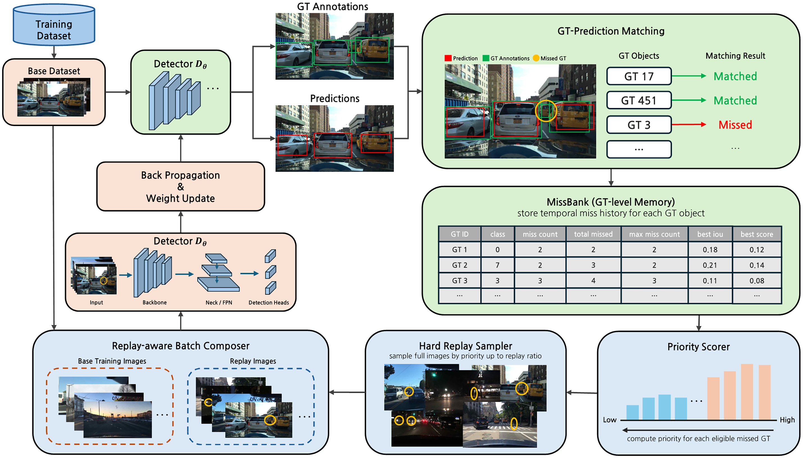
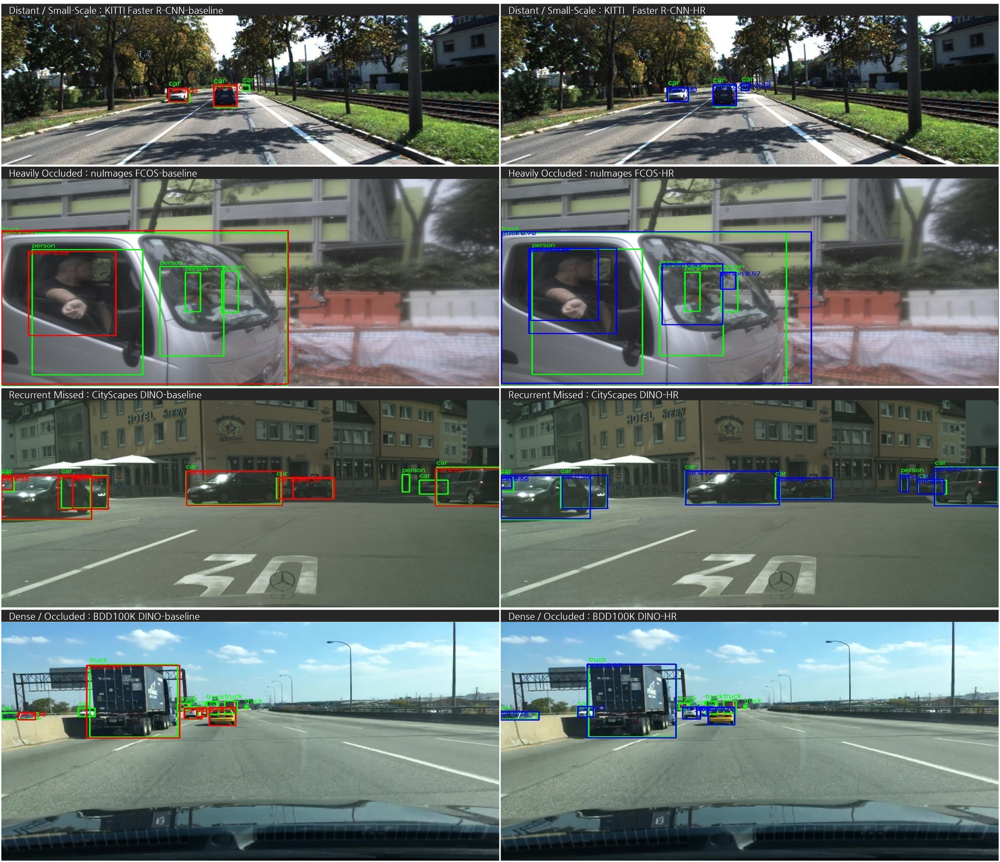

# ReMiss

Official PyTorch implementation of **"ReMiss: Missed-Object History for Data Scheduling in Driving-Scene Object Detection"**, published in *Computers, Materials & Continua (CMC)*, 2026.

**Authors:** Seongwook Lee, Seungyeong Kim, Jaemin Oh, L. Minh Dang, Hyeonjoon Moon
**DOI:** [10.32604/cmc.2026.087886](https://doi.org/10.32604/cmc.2026.087886) · [Paper page](https://www.techscience.com/cmc/online/detail/28371)



## Overview

Average precision is an aggregate metric: it does not tell you *which* annotated objects a detector keeps missing during training. ReMiss turns that blind spot into a training signal. It tracks, for every ground-truth instance, whether it was missed after final post-processing — and how often — then re-schedules full images containing repeatedly missed objects into later epochs. The detector architecture and loss stay untouched; only the data schedule changes, so there is no extra cost at inference.

- **Missed-object history as a training signal.** Recurrent missed detection is formalized at the annotation-instance level: a ground-truth object counts as missed when no same-class final prediction matches it across repeated mining snapshots.
- **MissBank.** An instance-level memory that records each ground-truth object's miss status, miss-count history, and localization/confidence diagnostics during offline, no-gradient mining.
- **Hard Replay.** A data-layer sampler that scores full images containing currently missed objects by miss counts and matching gaps, and schedules them into the next epoch under a replay budget. Because replay is image-level, scale, occlusion, and scene context are preserved.
- **Detector-agnostic evaluation.** Evaluated on KITTI, BDD100K, Cityscapes, and nuImages with FCOS, Faster R-CNN, and DINO — 12 dataset–detector pairs in total.



## Results

- With the replay ratio fixed in advance at 5.0%, all 12 dataset–detector pairs improve by **+0.64–+2.17 AP** over the no-replay baseline.
- Selecting the replay setting by validation mAP50:95 gives **+1.03–+2.23 AP**.
- Across the full replay-ratio sweep, all 36 configurations improve (minimum +0.22 AP, sign test p < 10⁻¹⁰).
- No additional inference cost; training time increases by 13–27% over the training-only baseline.



No-HR baseline (left) vs. validation-selected Hard Replay (right). Green: ground truth, red: baseline predictions, blue: Hard Replay predictions.

## Installation

```bash
git clone --recursive https://github.com/lee-seong-wook/remiss.git
cd remiss

conda create -n remiss python=3.12 -y
conda activate remiss
pip install torch torchvision --index-url https://download.pytorch.org/whl/cu128
pip install -r requirements.txt
```

`requirements.txt` pins the exact versions used for the paper (PyTorch 2.11, CUDA 12.8). Any PyTorch >= 2.5 should work.

DINO is built from the official [IDEA-Research/DINO](https://github.com/IDEA-Research/DINO) implementation, included as a submodule in `third-party/DINO`. FCOS and Faster R-CNN only need torchvision. To train DINO, compile the deformable attention operator and download the COCO-pretrained DINO-4scale R50 (12 epochs) checkpoint, `checkpoint0011_4scale.pth`, from the [DINO model zoo](https://github.com/IDEA-Research/DINO#model-zoo):

```bash
git submodule update --init
cd third-party/DINO/models/dino/ops && python setup.py build install && cd -
mkdir -p checkpoints/dino
mv /path/to/checkpoint0011_4scale.pth checkpoints/dino/
```

## Data Preparation

All datasets are read in COCO detection format (category ids start from 1; the number of classes is inferred from the annotation file). The expected layout is:

```
data/
├── kitti/
│   ├── images/{train,val}/
│   └── annotations/instances_{train,val}.json
├── bdd100k/
├── cityscapes/
└── nuimages/
```

Dataset paths are resolved from environment variables named `<DATASET>_{TRAIN,VAL}_{IMAGES,ANNOTATIONS}`. Copy the template and edit it if your data lives elsewhere:

```bash
cp .env.example .env
```

Datasets in YOLO format can be converted with:

```bash
python tools/yolo2coco.py --data /path/to/yolo_dataset
```

## Training

All commands are run from the repository root. `scripts/train.sh` runs the no-replay baseline and Hard Replay at replay ratios 2.5%, 5.0% and 7.5% for one dataset–detector pair, exactly as in the paper:

```bash
bash scripts/train.sh fcos kitti
bash scripts/train.sh fasterrcnn cityscapes
DEVICE="cuda:0 cuda:1" bash scripts/train.sh dino nuimages
```

A subset of runs can be selected with `baseline`, `r0025`, `r0050`, `r0075` (e.g. `bash scripts/train.sh fcos bdd100k baseline r0050`). Outputs are written to `runs/train/<dataset>/<detector>/<run>/`. To launch a single run directly:

```bash
python tools/train.py \
    --config configs/train/fcos.yaml \
    --model configs/models/fcos.yaml \
    --data kitti \
    --missbank-config configs/remiss/missbank.yaml \
    --hard-replay-config configs/remiss/hard_replay_r0050.yaml \
    --output-dir runs/train/kitti/fcos/HR-R0050
```

Passing several devices to `--device` (e.g. `--device cuda:0 cuda:1`) enables DDP; `loader.batch_size` is the global batch size.

| Config | Description |
| --- | --- |
| `configs/models/` | Detector definitions (FCOS, Faster R-CNN, DINO; ResNet-50) |
| `configs/train/` | Optimizer and schedule per detector (`*_cityscapes.yaml` and `dino_12ep.yaml`/`dino_24ep.yaml` follow the paper's per-dataset schedules) |
| `configs/remiss/missbank.yaml` | MissBank: mining start/interval, prediction–GT matching thresholds, miss threshold |
| `configs/remiss/hard_replay_*.yaml` | Hard Replay: start epoch, replay ratio, priority temperature, per-image and per-GT caps |

Besides checkpoints and validation metrics, each run records the MissBank state (`missbank/missbank_epoch.{json,csv}`) and the Hard Replay schedule (`hard-replay/hard_replay_epoch.{json,csv}`) of every epoch.

## Evaluation

```bash
python tools/eval.py \
    --config configs/eval.yaml \
    --model configs/models/fcos.yaml \
    --data kitti \
    --checkpoint runs/train/kitti/fcos/HR-R0050/checkpoints/best.pt
```

For DINO use `--model configs/models/dino_eval.yaml`, which skips the COCO initialization checkpoint.

## Repository Structure

```
remiss/
├── missbank.py       # MissBank: instance-level missed-object memory and prediction–GT matching
├── hard_replay.py    # Hard Replay: replay planning and mixed base/replay batch sampler
├── engine.py         # training loop, offline mining, validation, checkpointing
├── data.py           # COCO dataset and data loaders
├── metrics.py        # COCO detection metrics
└── models/           # FCOS, Faster R-CNN and DINO wrappers
tools/                # train.py, eval.py, yolo2coco.py
configs/              # model, training, MissBank and Hard Replay configs
scripts/train.sh      # paper experiments
```

## Citation

```bibtex
@article{lee2026remiss,
  author  = {Seongwook Lee and Seungyeong Kim and Jaemin Oh and L. Minh Dang and Hyeonjoon Moon},
  title   = {ReMiss: Missed-Object History for Data Scheduling in Driving-Scene Object Detection},
  journal = {Computers, Materials \& Continua},
  year    = {2026},
  doi     = {10.32604/cmc.2026.087886},
  note    = {Published online 20 September 2026}
}
```

## Acknowledgements

The DINO detector is built on [IDEA-Research/DINO](https://github.com/IDEA-Research/DINO); FCOS and Faster R-CNN use [torchvision](https://github.com/pytorch/vision).

## License

This project is released under the [MIT License](LICENSE).
